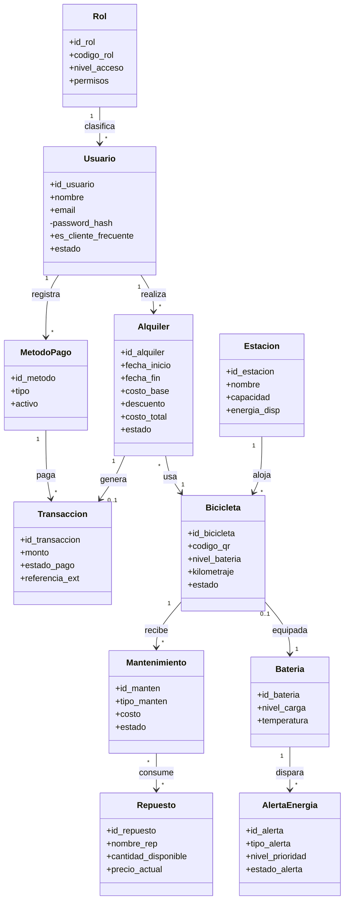
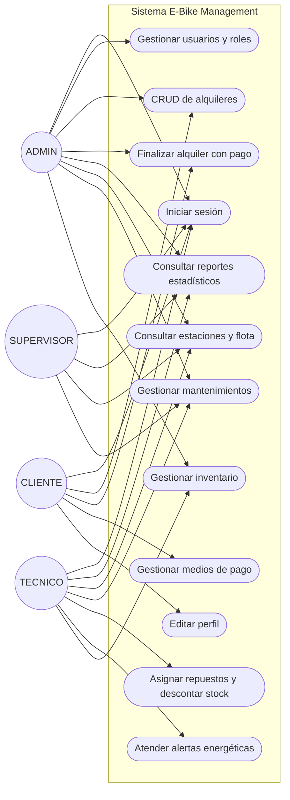

# E-Bike Management — Sistema de Gestión de Bicicletas Eléctricas

Implementación del SDD (Software Design Description) con **PHP nativo**, **MySQL/MariaDB**, **Bootstrap 5**, **HTML5 Canvas** y **SweetAlert2**.

> 📘 **¿Quieres aprender a construirlo?** Consulta el [TUTORIAL.md](TUTORIAL.md): guía paso a paso con diagramas de arquitectura, patrones, clases, secuencia, estados y flujos.

---

## ¿En qué consiste el sistema?

Plataforma web para administrar una red de bicicletas eléctricas y sus estaciones de carga:

- **Flota**: estado de cada bicicleta (batería, kilometraje, estación actual), baterías con temperatura e historial
- **Alquileres**: ciclo completo (reservar → activo → finalizar con cobro / anular), transacciones de pago y medios de pago por cliente
- **Clientes frecuentes**: descuento automático del 10 % aplicado por trigger a quienes superan 5 alquileres en 30 días (evaluados por evento diario)
- **Mantenimientos**: órdenes preventivas/correctivas con inventario de repuestos, control de stock y auditoría de cambios de estado
- **Energía**: alertas automáticas por batería baja o sobrecalentamiento, energía disponible por estación
- **Reportes estadísticos**: alquileres por día/semana/mes renderizados en Canvas (barras y dona interactivas), KPIs de ingresos y operación

## Arquitectura

Arquitectura **monolítica de 3 capas** con estilo **SPA + API JSON** (MVC simplificado):

| Capa | Tecnología | Componentes |
|---|---|---|
| **Presentación** (Vista) | Bootstrap 5, CSS propio, Canvas HTML5, SVG, SweetAlert2 | `index.php`, `assets/js/app.js`, `assets/js/graficos.js`, `assets/css/estilos.css` |
| **Lógica de negocio** (Controlador) | PHP nativo sin framework, PDO, sesiones, RBAC | `api/*.php`, `config/funciones.php` |
| **Datos** (Modelo) | MySQL/MariaDB: procedimientos almacenados, triggers, evento programado, constraints | `Bisicleta.sql` |

El frontend nunca accede a la base de datos: toda comunicación es `fetch` + JSON contra los endpoints, y la lógica crítica vive delegada en la base de datos.

### Patrones de diseño utilizados

| Patrón | Dónde |
|---|---|
| **Singleton** | `config/database.php` — una única conexión PDO por petición |
| **Front Controller** (simplificado) | Cada `api/*.php` recibe `?accion=` y despacha a un `switch` central |
| **MVC** (variante ligera) | Vista = SPA JS · Controlador = endpoints PHP · Modelo = SPs y triggers |
| **Data Mapper / DAO** (práctico) | Lectura con PDO `FETCH_ASSOC` hacia arrays transferibles en JSON |
| **Lógica en la base de datos** | Reglas de negocio centralizadas en SPs; integridad y reacciones en triggers (patrón *Observer* a nivel BD) |
| **Module Pattern + IIFE** | `app.js` y `graficos.js` con `'use strict'` y funciones encapsuladas |
| **Registry** | `$_SESSION` como almacén central de identidad (usuario, CSRF, actividad) |

## Tecnologías utilizadas y su propósito

| Tecnología | Qué es | Para qué se usó |
|---|---|---|
| **PHP 8 (nativo)** | Lenguaje de servidor sin framework | Toda la lógica: endpoints JSON, sesiones, RBAC, hashing de contraseñas, validaciones |
| **PDO + MySQL/MariaDB** | Capa de acceso a datos con consultas preparadas | Persistencia segura (anti SQL Injection); `EMULATE_PREPARES = false` |
| **Procedimientos almacenados** | Código SQL ejecutable dentro del servidor | CRUD de alquileres, pagos, repuestos y reportes (`sp_reporte_cantidad_alquileres`) |
| **Triggers** | Reacciones automáticas de la BD | Descuento frecuente 10 %, estados de bicicletas, auditoría, alertas energéticas |
| **Eventos programados** | Tareas automáticas de la BD | Reevaluación diaria de clientes frecuentes |
| **Bootstrap 5.3 (CDN)** | Framework CSS responsivo | Rejilla, tablas, botones, navbar, adaptación móvil/tablet/escritorio |
| **Bootstrap Icons (CDN)** | Set de iconos SVG | Iconografía de menús, botones y tarjetas |
| **SweetAlert2 (CDN)** | Librería de diálogos | Todos los modales (formularios CRUD) y alertas/toasts |
| **HTML5 Canvas + JS vanilla** | Lienzo de dibujo nativo | Gráficos estadísticos propios (barras y dona, tooltip y animación, sin librerías de gráficos) |
| **SVG embebido** | Gráficos vectoriales | Fondo del login: parque con bicicleta eléctrica **en tránsito** animada (SMIL), efecto relieve con `feDropShadow`, paleta del sistema |
| **CSS3 personalizado** | Hoja de estilos propia | Paleta verde caro 55 % / menta 30 % / oliva 15 % / dorado 10 %, relieve, responsivo |
| **HTML5 semántico** | Estructura de la SPA | Shell única (`index.php`) que carga vistas por JS |
| **Sesiones PHP + `random_bytes`** | Mecanismos nativos de seguridad | Autenticación, vencimiento por inactividad y token CSRF |
| **Laragon** | Entorno local todo-en-uno | Servidor Apache + PHP 8 + MariaDB en Windows |
| **Git + GitHub** | Control de versiones | Historial y publicación del código |

> **Sin Composer ni npm**: el proyecto no tiene dependencias instalables. Las tres librerías de frontend (Bootstrap, Bootstrap Icons, SweetAlert2) cargan por CDN.

## Seguridad — capas mapeadas al modelo OSI

| Capa OSI | Control de seguridad en el sistema | Estado |
|---|---|---|
| **1. Física** | Infraestructura local: la BD y el código residen en el equipo (Laragon), credenciales en `config/config.php` fuera de la carpeta pública de lógica | Implementado |
| **2. Enlace** | Red local doméstica; sin exposición de puertos a internet | Implementado (por alcance local) |
| **3. Red** | Servicio dirigido a `localhost`; sin rutas públicas hacia el backend | Implementado (por alcance local) |
| **4. Transporte** | Conexiones HTTP controladas por Apache; `GIT_TERMINAL_PROMPT`/credenciales gestionadas por el SO para despliegue | Parcial — en producción aplicar HTTPS |
| **5. Sesión** | Sesiones PHP con `session_regenerate_id()` (anti fixation), **vencimiento por inactividad (30 min)**, destrucción al salir, cookie de sesión | Implementado |
| **6. Presentación** | JSON UTF-8 consistente, mensajes de error depurados (sin stack traces), token **CSRF** entregado/embebido en formato JSON | Implementado |
| **7. Aplicación** | **RBAC por endpoint**, propiedad de recursos (cada cliente solo ve lo suyo), **prepared statements** (anti SQL Injection), validación y whitelist de entradas, `password_hash()` bcrypt, **token CSRF** verificado con `hash_equals` en todo POST, reglas de negocio con `SIGNAL`/transacciones en la BD | Implementado |

Mejora futura recomendada: cabeceras HTTP de seguridad (CSP, HSTS) y limitación de intentos de login (anti fuerza bruta).

## Diagrama de clases (modelo de datos)



## Diagrama de casos de uso



## Instalación paso a paso (entorno local)

> El proyecto se trabaja **100 % local** con Laragon. **No se necesita Composer ni npm** — no hay librerías instalables; las de frontend cargan por CDN.

### 1. Instalar Laragon (incluye PHP, MariaDB y Apache)

1. Descargar Laragon "Full" desde https://laragon.org/download/
2. Instalar con opciones por defecto (ruta recomendada: `C:\laragon`)
3. Verificar que incluya **PHP 8+** y **MariaDB 10.10+** (o MySQL 8+): menú Laragon → MySQL/MariaDB

### 2. Obtener el código

```powershell
cd C:\laragon\www
git clone https://github.com/LillianaU/BisicletaPHPlargo.git Bisicleta
```
(o descargar el ZIP y descomprimirlo en `C:\laragon\www\Bisicleta`)

### 3. Iniciar los servicios

Abrir Laragon → botón **Start All** (Apache + MariaDB quedan corriendo).

### 4. Importar la base de datos

Opción A — línea de comandos (recomendada):

```powershell
& "C:\laragon\bin\mysql\mysql-X.X.X-winx64\bin\mysql.exe" -u root --default-character-set=utf8mb4 -e "source C:/laragon/www/Bisicleta/Bisicleta.sql"
```

Opción B — gráfica: abrir **HeidiSQL** (incluido en Laragon) → conectar a `127.0.0.1` con usuario `root` sin contraseña → menú File → Run SQL file → seleccionar `Bisicleta.sql`.

El script crea todo: base `ebike_management`, 16 tablas, 13 triggers, 10 procedimientos almacenados, evento diario y datos de demostración (estaciones, flota, inventario, alquileres históricos y mantenimientos).

### 5. Configurar credenciales (solo si cambió algo)

`config/config.php` viene listo para Laragon (host `127.0.0.1`, usuario `root`, sin contraseña). Edítalo únicamente si tu MariaDB usa otra clave o puerto.

### 6. (Opcional) Regenerar usuarios de prueba

Abrir en el navegador `http://localhost/Bisicleta/creacion_usuario_prueba.php` — crea/restaura los usuarios demo con `password_hash()` y muestra la contraseña asignada a cada uno.

### 7. Abrir la aplicación

Entrar a `http://localhost/Bisicleta/` e iniciar sesión:

| Email | Contraseña | Rol |
|---|---|---|
| admin@ebike.com | Admin123* | ADMIN |
| tecnico@ebike.com | Tecnico123* | TECNICO |
| cliente@ebike.com | Cliente123* | CLIENTE |
| supervisor@ebike.com | Cliente123* | SUPERVISOR |

### 8. Notas sobre las librerías (CDN)

| Librería | Carga desde | Uso |
|---|---|---|
| Bootstrap 5.3 | `cdn.jsdelivr.net` | Estilos y rejilla |
| Bootstrap Icons | `cdn.jsdelivr.net` | Iconos |
| SweetAlert2 | `cdn.jsdelivr.net` | Modales y alertas |

Funcionan **con internet**. Para uso 100 % offline, descargar los 3 archivos y alojarlos en `assets/vendor/`, actualizando las rutas en `index.php`.

## Instalación (resumen rápido)

1. Clonar en `C:\laragon\www\Bisicleta` · 2. Start All en Laragon · 3. Importar `Bisicleta.sql` · 4. Abrir `http://localhost/Bisicleta/` · 5. Iniciar sesión.

## Estructura del proyecto

```
Bisicleta/
├── Bisicleta.sql                  Script completo de BD (importar con utf8mb4)
├── creacion_usuario_prueba.php    Alta de usuarios de prueba (script independiente)
├── TUTORIAL.md                    Tutorial paso a paso con diagramas (Mermaid)
├── index.php                      Shell de la SPA
├── config/
│   ├── config.php                 Credenciales BD (Laragon: root sin clave)
│   ├── database.php               Singleton PDO
│   └── funciones.php              Sesión (TTL 30 min), CSRF, RBAC, JSON
├── api/
│   ├── auth.php                   login / logout / me (emite token CSRF)
│   ├── alquileres.php             CRUD vía SPs + finalizar + anular
│   ├── reportes.php               resumen KPIs + sp_reporte_cantidad_alquileres
│   ├── catalogos.php              estaciones, bicicletas, clientes, repuestos, medios
│   ├── usuarios.php               gestión usuarios + perfil
│   ├── mantenimientos.php         órdenes + repuestos + finalizar/cancelar
│   ├── inventario.php             CRUD repuestos
│   ├── alertas.php                alertas energéticas (atender/cerrar)
│   └── pagos.php                  medios de pago del cliente
└── assets/
    ├── css/estilos.css            Paleta 55/30/15/10, relieve, responsivo
    └── js/
        ├── app.js                 SPA (vistas, modales SweetAlert2, CSRF, fondo SVG animado del login)
        └── graficos.js            Motor Canvas (barras + dona, tooltip, leyenda)
```
