# Tutorial completo: cómo programar E-Bike Management paso a paso

> Guía didáctica para construir **desde cero** este sistema de gestión de bicicletas eléctricas
> con PHP nativo, MariaDB, Bootstrap, Canvas y SweetAlert2.
>
> Cada etapa explica **qué se construye**, **por qué se hace así** y **cómo verificarlo**.
> Los diagramas están hechos con Mermaid y se renderizan directamente en GitHub.

---

## Índice

1. [Qué vas a construir y qué vas a aprender](#1-qué-vas-a-construir-y-qué-vas-a-aprender)
2. [Arquitectura: cómo se organiza el sistema](#2-arquitectura-cómo-se-organiza-el-sistema)
3. [Patrones de diseño usados (con diagramas)](#3-patrones-de-diseño-usados-con-diagramas)
4. [Parte I — Preparar el entorno](#parte-i--preparar-el-entorno)
5. [Parte II — La base de datos paso a paso](#parte-ii--la-base-de-datos-paso-a-paso)
6. [Parte III — El backend PHP](#parte-iii--el-backend-php)
7. [Parte IV — El frontend SPA](#parte-iv--el-frontend-spa)
8. [Parte V — Seguridad en capas](#parte-v--seguridad-en-capas)
9. [Parte VI — Pruebas](#parte-vi--pruebas)
10. [Parte VII — Flujos completos del sistema](#parte-vii--flujos-completos-del-sistema)
11. [Parte VIII — Publicar en GitHub](#parte-viii--publicar-en-github)
12. [Checklist de construcción por etapas](#checklist-de-construcción-por-etapas)
13. [Glosario](#glosario)

---

## 1. Qué vas a construir y qué vas a aprender

**El sistema**: una plataforma web que administra una red de bicicletas eléctricas —
flota, estaciones, alquileres con cobro, medios de pago, mantenimientos con repuestos,
alertas de batería, descuentos para clientes frecuentes y reportes estadísticos.

**Módulos y responsables**:

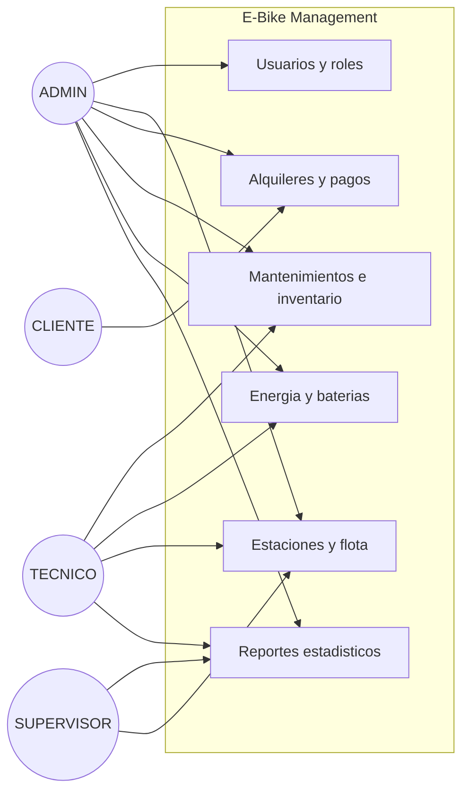

**Lo que aprenderás**:

| Área | Qué practicarás |
|---|---|
| Base de datos | Diseño relacional, llaves foráneas, `CHECK`, triggers, procedimientos almacenados, eventos, transacciones |
| PHP nativo | PDO con consultas preparadas, sesiones, `password_hash`, RBAC, arquitectura de endpoints JSON |
| Frontend | SPA con `fetch`, renderizado por plantillas, Bootstrap, modales con SweetAlert2 |
| Canvas | Motor de gráficos propio: escalado por DPR, ejes, animación, tooltips |
| SVG | Fondo animado con filtros de relieve y animación SMIL |
| Seguridad | Hashing, CSRF, vencimiento de sesión, propiedad de recursos, mapeo al modelo OSI |

---

## 2. Arquitectura: cómo se organiza el sistema

El sistema es **monolítico de 3 capas** con estilo **SPA + API JSON** (una variante ligera de MVC).

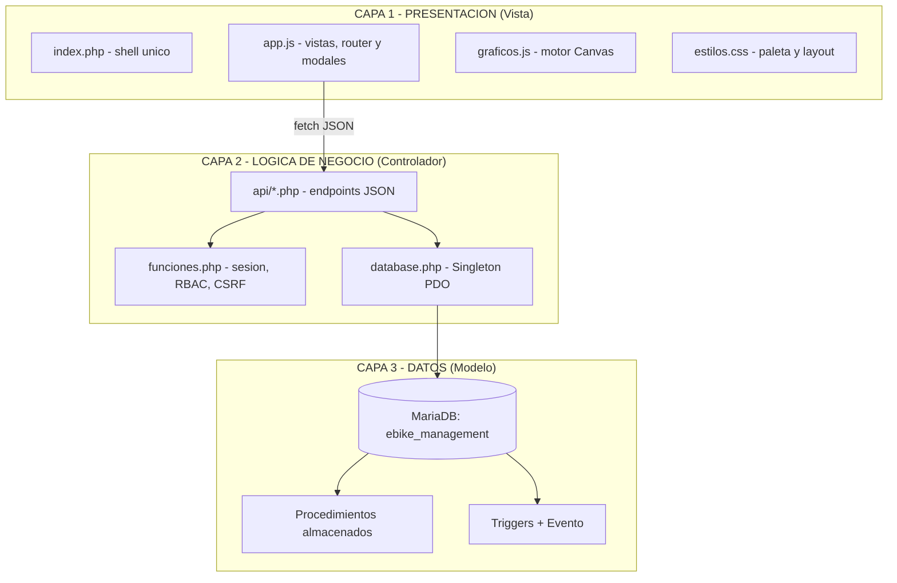

**Reglas de oro de esta arquitectura:**

1. El frontend **nunca** habla con la base de datos: solo con `api/*.php`.
2. La lógica crítica (descuentos, validaciones, estados) vive en **SPs y triggers**, no en el PHP ni en el JS.
3. Cada petición es **sin estado** del lado del PHP: la identidad viaja en la **sesión**; el resto se reconstruye en cada request.

### El recorrido de una petición

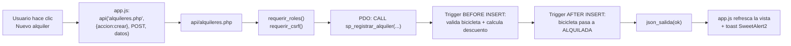

---

## 3. Patrones de diseño usados (con diagramas)

### 3.1 Singleton — una sola conexión a la base de datos

**Problema**: abrir una conexión nueva por cada consulta es costoso y disperso.
**Solución**: una clase que garantiza **una única instancia** de `PDO` por petición.

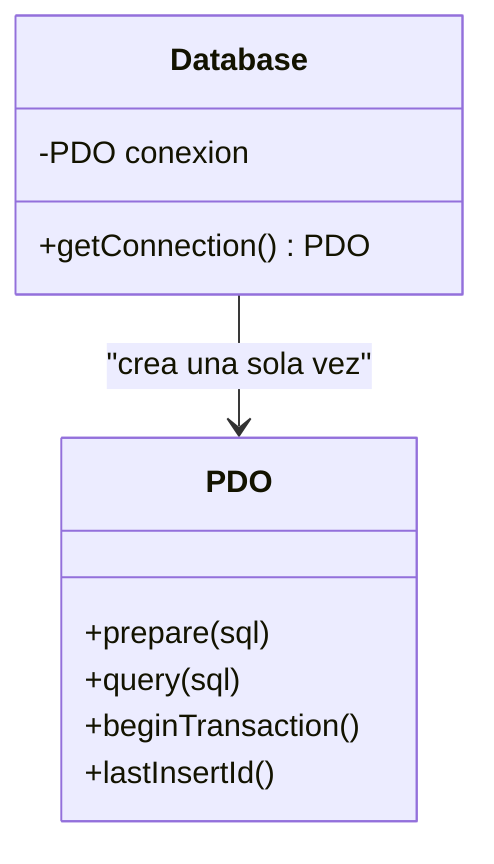

```php
class Database
{
    private static ?PDO $conexion = null;      // estado compartido

    public static function getConnection(): PDO
    {
        if (self::$conexion === null) {        // sólo la primera vez
            $cfg = require __DIR__ . '/config.php';
            $dsn = "mysql:host={$cfg['host']};dbname={$cfg['basedatos']};charset=utf8mb4";
            self::$conexion = new PDO($dsn, $cfg['usuario'], $cfg['clave'], [
                PDO::ATTR_ERRMODE            => PDO::ERRMODE_EXCEPTION,
                PDO::ATTR_DEFAULT_FETCH_MODE => PDO::FETCH_ASSOC,
                PDO::ATTR_EMULATE_PREPARES   => false,   // preparadas reales
            ]);
        }
        return self::$conexion;
    }
}
```

**Por qué funciona**: `static` pertenece a la clase, no al objeto; la condición `=== null` actúa de candado lógico.

### 3.2 Front Controller (simplificado) — un punto de entrada por recurso

Cada archivo de `api/` recibe `?accion=...` y despacha con un `switch`. El navegador siempre entra por el mismo archivo; la acción decide qué hacer.

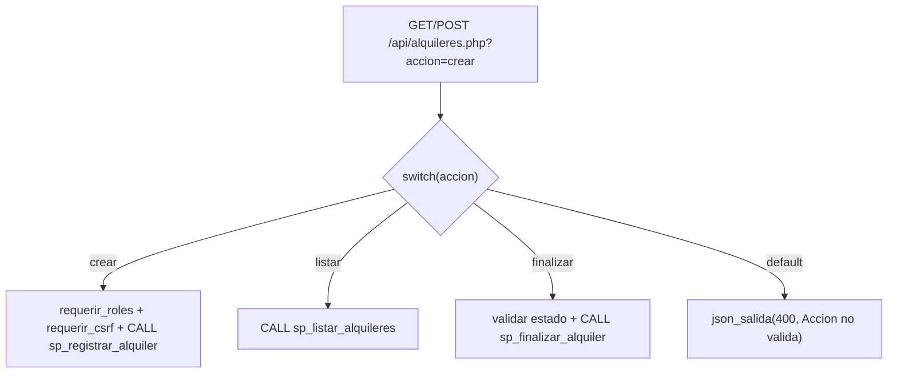

**Por qué funciona**: un solo archivo por recurso concentra validaciones comunes (rol, CSRF, try/catch) y evita decenas de scripts sueltos.

### 3.3 MVC ligero — vista, controlador y modelo separados

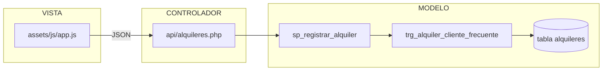

| Concepto MVC | En este proyecto |
|---|---|
| Modelo | SPs + triggers + tablas (¡el modelo vive en SQL!) |
| Vista | `app.js` + `estilos.css` (render en el cliente) |
| Controlador | Los endpoints `api/*.php` |

### 3.4 DAO / Data Mapper práctico — acceso a datos encapsulado

Las APIs no arman SQL disperso: **delegan todo en SPs** y transfieren los resultados como arrays JSON.

```php
$stmt = $pdo->prepare('CALL sp_listar_alquileres(?, ?)');
$stmt->execute([$idFiltro, $estado]);
$filas = $stmt->fetchAll();     // array asociativo listo para JSON
```

### 3.5 Observer (a nivel de base de datos) — los triggers reaccionan solos

Cuando cambia el estado de una bicicleta, **nadie en PHP avisa**: el trigger se dispara.

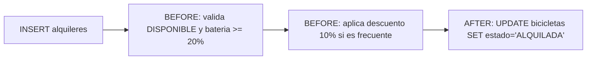

### 3.6 Module Pattern + IIFE — encapsular el JavaScript

`app.js` y `graficos.js` declaran `'use strict'` y agrupan funciones; nada se filtra al `window` salvo lo necesario.

```js
'use strict';
let USUARIO = null;          // estado del módulo
async function api(...) { }  // helpers privados
function mostrarLogin() { }
```

### 3.7 Registry — `$_SESSION` como almacén de identidad

La sesión guarda **quién eres**, tu **token CSRF** y tu **última actividad**: un único lugar consultado por todos los endpoints.

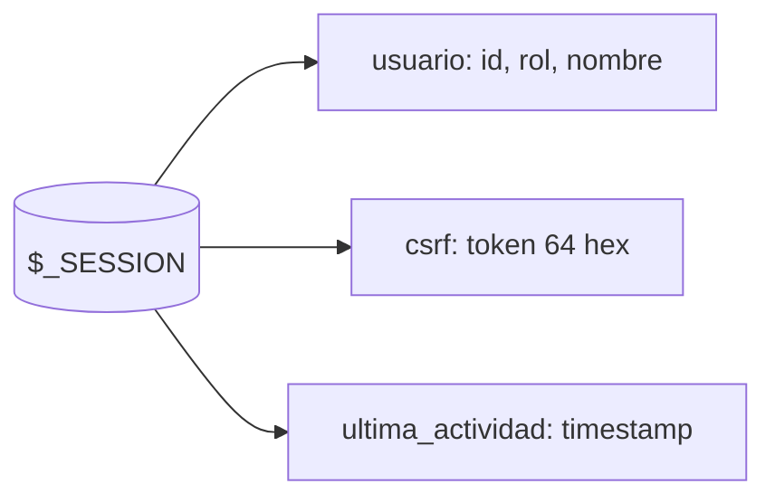

---

## Parte I — Preparar el entorno

**Objetivo**: tener Apache + PHP 8 + MariaDB funcionando en local.

### Paso 1. Instalar Laragon

1. Descargar Laragon **Full** desde https://laragon.org/download/
2. Instalar por defecto (`C:\laragon`) e iniciar → botón **Start All**.
3. Verificar componentes:

```powershell
php -v                          # PHP 8.x
& "C:\laragon\bin\mysql\mysql-8.4.3-winx64\bin\mysql.exe" -u root -e "SELECT VERSION();"
```

> **¿Por qué Laragon?** Instala y arranca Apache, PHP y MariaDB en un clic, y expone
> `C:\laragon\www` como raíz web: crear `C:\laragon\www\Bisicleta` ya es servir la app.

### Paso 2. Crear la carpeta del proyecto

```powershell
mkdir C:\laragon\www\Bisicleta
cd C:\laragon\www\Bisicleta
```

### Paso 3. Verificar que el servidor responde

Crea `index.php` con `<?php echo 'Hola';` y abre `http://localhost/Bisicleta/`.
Si ves "Hola", Apache está sirviendo tu carpeta.

**Diagrama del entorno:**

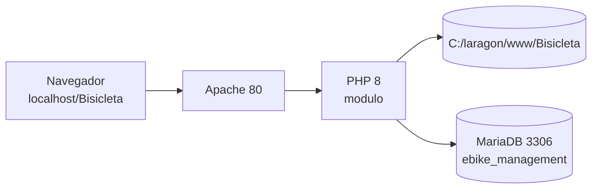

---

## Parte II — La base de datos paso a paso

**Objetivo**: modelar todo el dominio en SQL, con la **lógica crítica dentro de la base**.

### Diagrama de clases (modelo de datos)

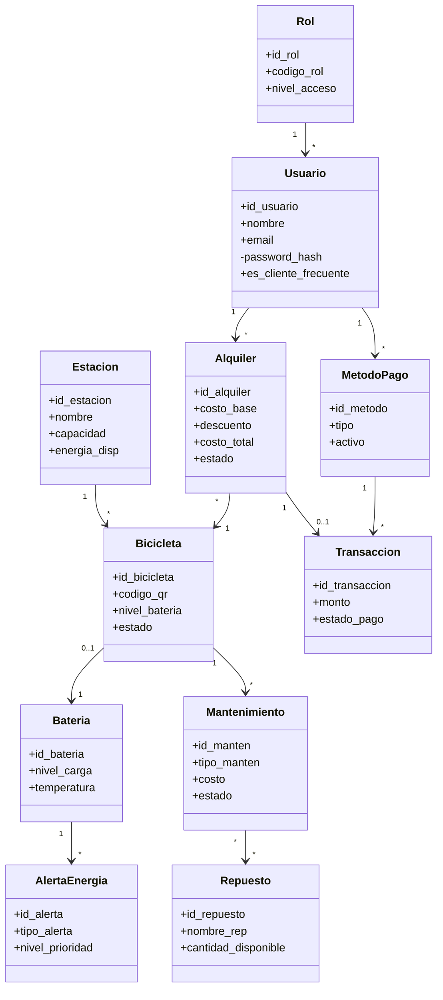

### Etapa 2.1 — Crear la base y las primeras tablas

```sql
DROP DATABASE IF EXISTS ebike_management;
CREATE DATABASE ebike_management CHARACTER SET utf8mb4 COLLATE utf8mb4_unicode_ci;
USE ebike_management;
SET NAMES utf8mb4;               -- imprescindible: tildes y ñ correctas

CREATE TABLE roles (
    id_rol INT UNSIGNED AUTO_INCREMENT PRIMARY KEY,
    codigo_rol VARCHAR(30) NOT NULL UNIQUE,     -- ADMIN, TECNICO, CLIENTE...
    nombre_rol VARCHAR(100) NOT NULL,
    nivel_acceso TINYINT UNSIGNED NOT NULL DEFAULT 1,
    CONSTRAINT chk_roles_nivel CHECK (nivel_acceso BETWEEN 1 AND 10)
) ENGINE=InnoDB;

CREATE TABLE usuarios (
    id_usuario BIGINT UNSIGNED AUTO_INCREMENT PRIMARY KEY,
    uuid CHAR(36) NOT NULL UNIQUE DEFAULT (UUID()),   -- genera UUID solo
    nombre VARCHAR(150) NOT NULL,
    email VARCHAR(150) NOT NULL UNIQUE,
    password_hash VARCHAR(255) NOT NULL,
    estado ENUM('ACTIVO','INACTIVO','BLOQUEADO') NOT NULL DEFAULT 'ACTIVO',
    es_cliente_frecuente BOOLEAN NOT NULL DEFAULT FALSE,
    cantidad_alquileres INT UNSIGNED NOT NULL DEFAULT 0,
    rol_id INT UNSIGNED NOT NULL,
    CONSTRAINT fk_usuarios_roles FOREIGN KEY (rol_id) REFERENCES roles(id_rol)
) ENGINE=InnoDB;
```

> **Por qué `DEFAULT (UUID())` y no sólo un trigger**: en modo estricto, MariaDB valida
> los `NOT NULL` **antes** de ejecutar los triggers `BEFORE INSERT`. El default cubre ese
> hueco y el trigger queda como red de seguridad.

Continúa con `estaciones`, `bicicletas`, `alquileres`, `metodos_pago`, `transacciones`,
`inventario_costos`, `mantenimientos`, `mantenimiento_repuestos`, `logs_auditoria`,
`baterias`, `historial_carga`, `alertas_energia` y `registro_energia` (todas en `Bisicleta.sql`).

**Claves del diseño:**

| Decisión | Por qué |
|---|---|
| `BIGINT UNSIGNED` en transaccionales | crecerán más rápido que los catálogos |
| `ENUM` para estados | valida en la BD, no sólo en la app |
| `CHECK` para montos/batería | integridad incluso ante inserciones manuales |
| `ON DELETE RESTRICT` en lo financiero | no permitir borrar un usuario con alquileres |
| `ON DELETE SET NULL` en lo opcional | borrar una estación no debe borrar bicicletas |

### Etapa 2.2 — Los estados del negocio (máquinas de estado)

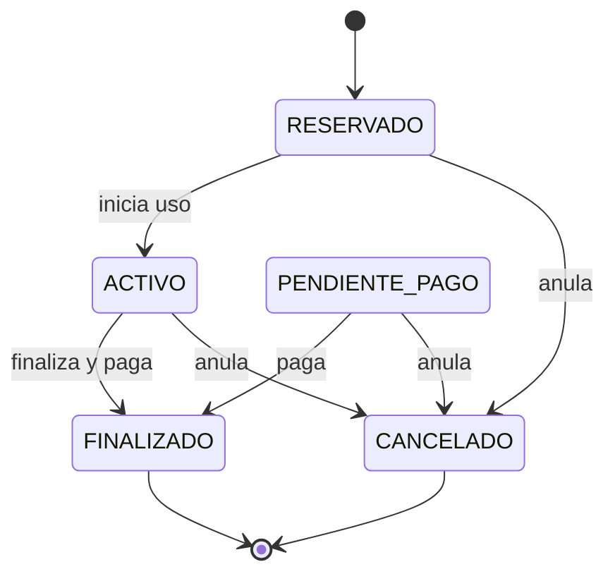

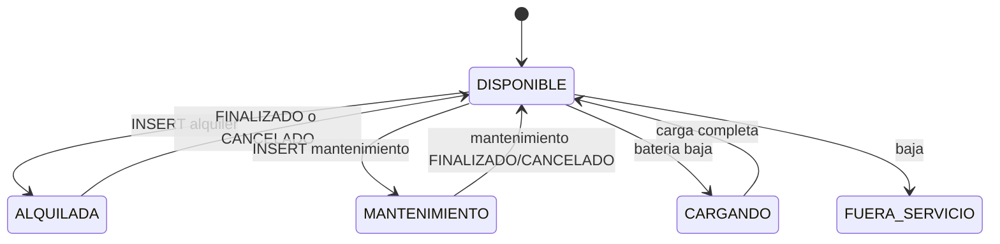

### Etapa 2.3 — Triggers: que la base se defienda sola

**Trigger 1 — descuento de cliente frecuente** (`BEFORE INSERT`):

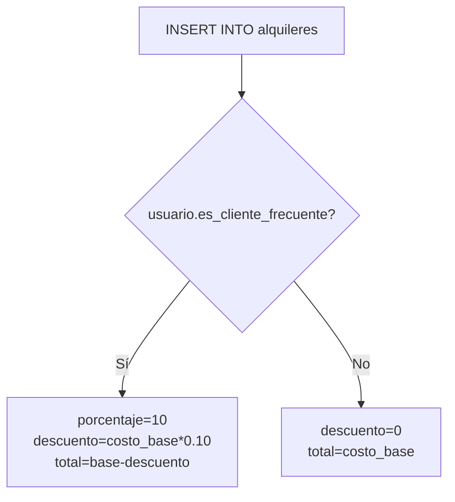

**Trigger 2 — validación de bicicleta** (`BEFORE INSERT`):

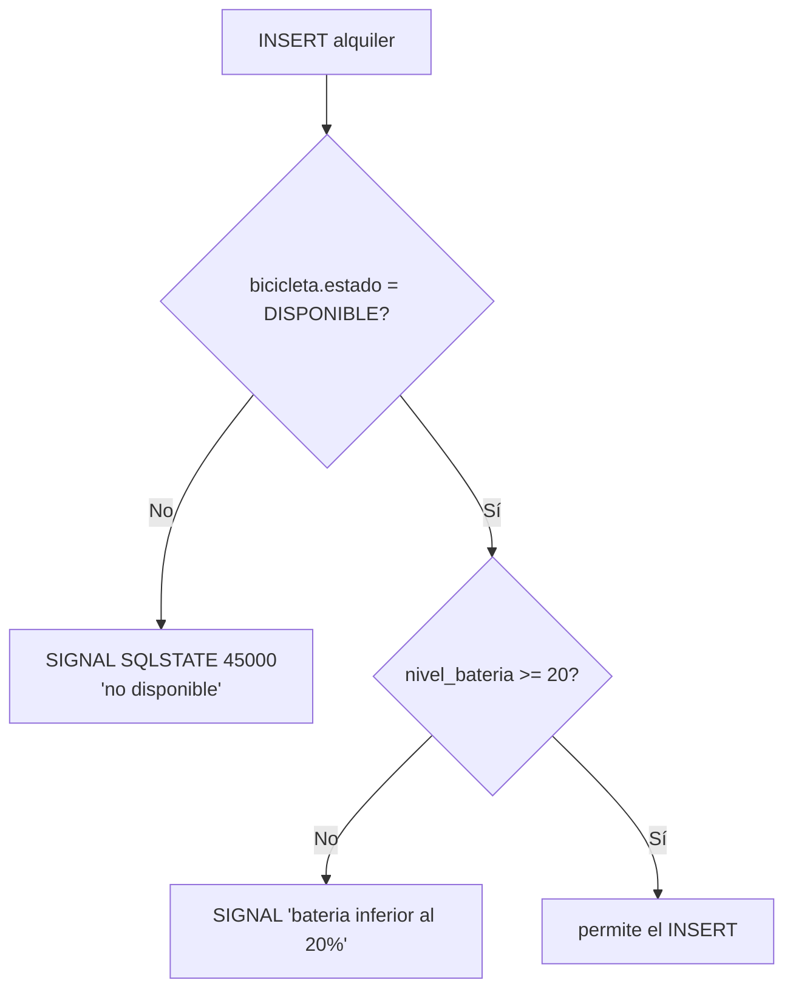

**Trigger 3 — la bicicleta se alquila** (`AFTER INSERT`): `UPDATE bicicletas SET estado='ALQUILADA'`.
**Trigger 4 — se libera al finalizar/anular** (`AFTER UPDATE`).
**Trigger 5 — auditoría** de cambios de estado de mantenimiento (`INSERT INTO logs_auditoria`).
**Trigger 6 — alerta de batería baja / sobretemperatura** (`AFTER UPDATE ON baterias`).

> **Regla clave al escribir triggers**: los `DECLARE` van **al inicio** del bloque `BEGIN`.
> Ponerlos dentro de un `IF` es un error de sintaxis.

### Etapa 2.4 — Procedimientos almacenados (flujo de negocio)

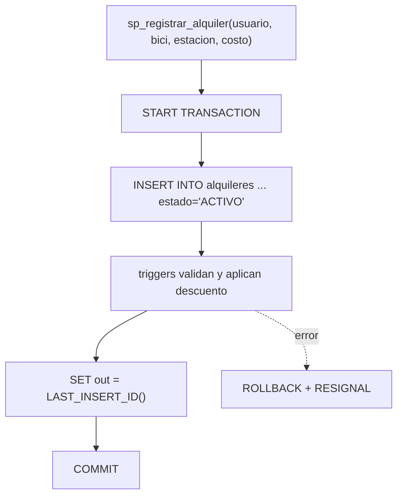

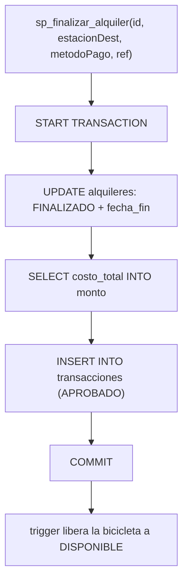

El procedimiento maestro de reportes usa **CTE recursivos** para generar todas las horas/días, incluso los que no tienen alquileres:

```sql
CREATE PROCEDURE sp_reporte_cantidad_alquileres(IN p_tipo VARCHAR(10))
BEGIN
    IF p_tipo = 'DIA' THEN
        WITH RECURSIVE horas AS (SELECT 0 AS h UNION ALL SELECT h+1 FROM horas WHERE h < 23)
        SELECT CONCAT(LPAD(h,2,'0'),':00') AS etiqueta,
               (SELECT COUNT(*) FROM alquileres
                 WHERE DATE(fecha_inicio)=CURDATE() AND HOUR(fecha_inicio)=h) AS cantidad
        FROM horas;
    ELSEIF p_tipo = 'SEMANA' THEN
        -- 7 días de la semana actual
        ...
    ELSE
        -- todos los días del mes actual
        ...
    END IF;
END
```

### Etapa 2.5 — El evento diario

```sql
SET GLOBAL event_scheduler = ON;
CREATE EVENT ev_actualizar_clientes_frecuentes
ON SCHEDULE EVERY 1 DAY STARTS CURRENT_TIMESTAMP + INTERVAL 1 DAY
DO
   -- re-evalúa: >= 5 alquileres finalizados en 30 días => cliente frecuente
```

### Verificar la Parte II

```sql
SELECT COUNT(*) FROM information_schema.TRIGGERS WHERE TRIGGER_SCHEMA='ebike_management';  -- 13
SHOW PROCEDURE STATUS WHERE Db='ebike_management';                                        -- 10
CALL sp_reporte_cantidad_alquileres('SEMANA');
```

---

## Parte III — El backend PHP

### Etapa 3.1 — Configuración y conexión

`config/config.php` (datos del entorno, aislados del código):

```php
return [
    'host' => '127.0.0.1', 'puerto' => '3306',
    'basedatos' => 'ebike_management',
    'usuario' => 'root', 'clave' => '', 'charset' => 'utf8mb4',
];
```

`config/database.php` → el **Singleton** de la sección de patrones.

### Etapa 3.2 — Utilidades transversales (`config/funciones.php`)

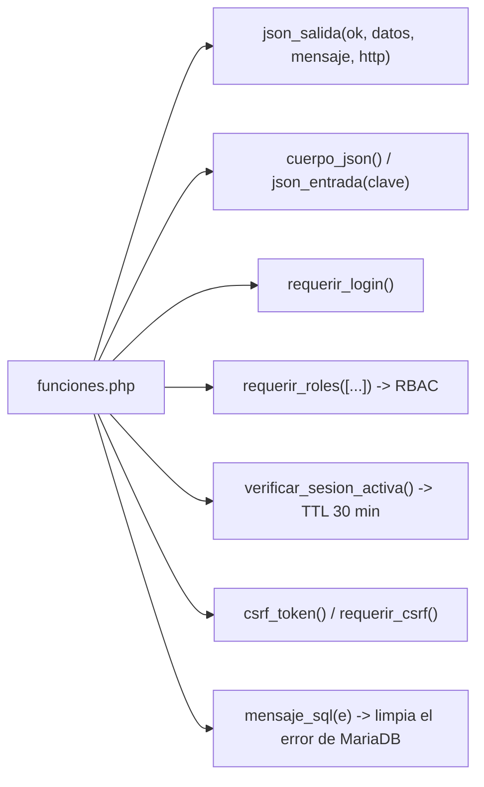

**El flujo de autenticación/autorización de cada request:**

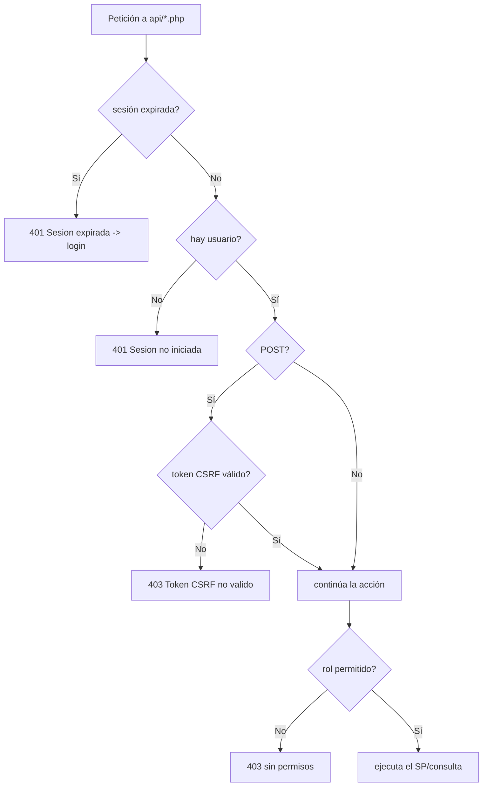

### Etapa 3.3 — Login paso a paso (`api/auth.php`)

**Diagrama de secuencia del login:**

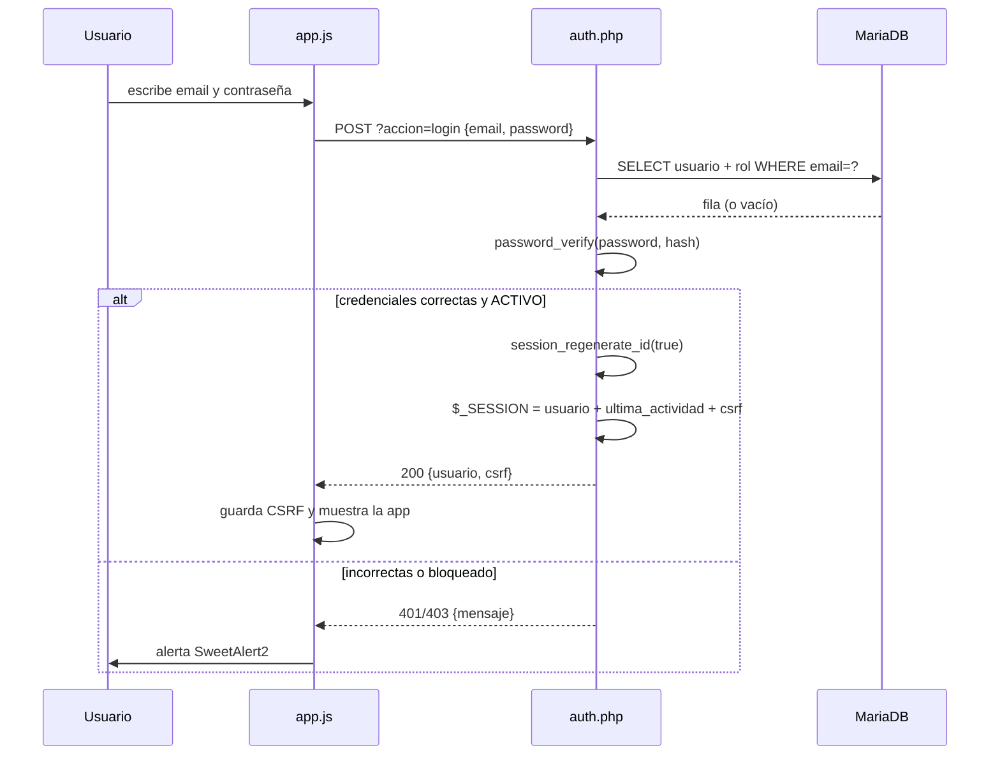

```php
$stmt = $pdo->prepare("SELECT u.*, r.codigo_rol FROM usuarios u
                       JOIN roles r ON r.id_rol = u.rol_id WHERE u.email = ? LIMIT 1");
$stmt->execute([$email]);
$fila = $stmt->fetch();

if (!$fila || !password_verify($password, $fila['password_hash'])) {
    json_salida(false, null, 'Credenciales incorrectas', 401);
}
session_regenerate_id(true);                  // evita fijación de sesión
$_SESSION['usuario'] = [...];
json_salida(true, ['usuario' => $_SESSION['usuario'], 'csrf' => csrf_token()]);
```

### Etapa 3.4 — El CRUD de alquileres (`api/alquileres.php`)

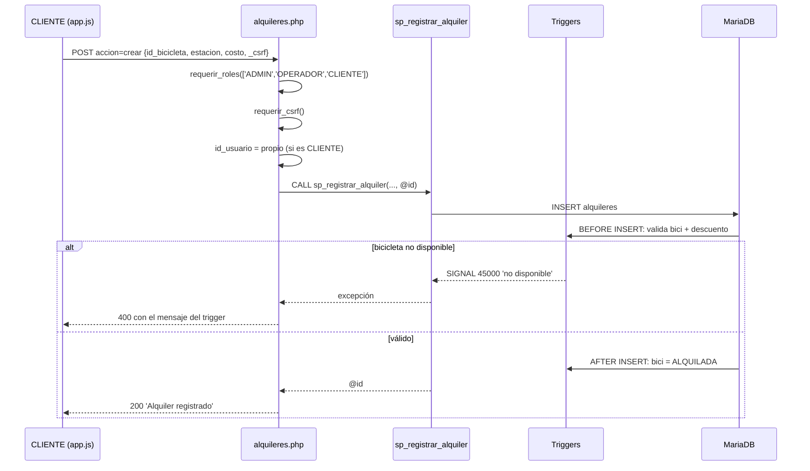

Operaciones y su regla de negocio:

| Acción | Verificación en PHP | Lógica en BD |
|---|---|---|
| `listar` | CLIENTE → sólo sus filas | `sp_listar_alquileres(usuario, estado)` |
| `crear` | rol + CSRF + dueño | `sp_registrar_alquiler` + triggers |
| `actualizar` | dueño; sólo estados editables | `sp_actualizar_alquiler` (exige RESERVADO/PENDIENTE_PAGO) |
| `finalizar` | dueño + estado ACTIVO/RESERVADO | `sp_finalizar_alquiler` + transacción |
| `anular` | dueño | `sp_anular_alquiler` (liberación por trigger) |

### Etapa 3.5 — El resto de módulos

Repite el mismo patrón (Front Controller + RBAC + CSRF + SP/consulta + `json_salida`):
`catalogos.php` (estaciones, bicicletas, clientes, repuestos, medios), `usuarios.php`
(gestión + perfil), `mantenimientos.php` (órdenes + repuestos + finalizar), `inventario.php`,
`alertas.php`, `pagos.php`, `reportes.php` (KPIs + gráficos).

### Etapa 3.6 — El script de usuarios de prueba

`creacion_usuario_prueba.php` es un **script aislado** del flujo público: recorre un array
de usuarios, resuelve el `id_rol` y hace `INSERT`/`UPDATE` con `password_hash()`, mostrando
la contraseña asignada. Sirve para poblar y **reproducir** entornos de prueba.

---

## Parte IV — El frontend SPA

### Etapa 4.1 — El shell (`index.php`)

```mermaid
flowchart TD
    INIT["index.php"] --> C1["CDN: Bootstrap 5 + Icons + SweetAlert2"]
    INIT --> C2["assets/css/estilos.css"]
    INIT --> C3["assets/js/graficos.js"]
    INIT --> C4["assets/js/app.js"]
    C4 --> BOOT["iniciar(): api('auth.php', accion=me)"]
    BOOT -->|200| APP["mostrarApp(): sidebar + topbar + vistas"]
    BOOT -->|401| LOGIN["mostrarLogin(): tarjeta + fondo SVG"]
```

### Etapa 4.2 — Paleta y layout (`assets/css/estilos.css`)

```css
:root {
    --verde-caro:  #0f3d2e;   /* 55 %  estructura */
    --verde-menta: #bfe6d8;   /* 30 %  superficies */
    --verde-oliva: #7a8b3f;   /* 15 %  secundarios */
    --dorado:      #d4af37;   /* 10 %  acentos */
}
```

La rejilla de Bootstrap da lo responsivo; el CSS propio da la identidad (55/30/15/10).

### Etapa 4.3 — El cliente de API y el router (`app.js`)

**Un único helper `api()`** concentra: URL, método, CSRF, manejo de 401 y captura del token.

```js
async function api(archivo, params = {}, metodo = 'GET', datos = null) {
    const qs = '?' + new URLSearchParams(params);
    const opciones = { method: metodo, headers: {} };
    if (metodo !== 'GET') {
        opciones.headers['Content-Type'] = 'application/json';
        opciones.body = JSON.stringify({ _csrf: CSRF, ...(datos || {}) });
    }
    const resp = await fetch('api/' + archivo + qs, opciones);
    const json = await resp.json();
    if (json.datos?.csrf) CSRF = json.datos.csrf;       // refresca token
    if (resp.status === 401 && USUARIO) {               // sesión caída
        const expirada = (json.mensaje || '').includes('expirada');
        USUARIO = null;
        if (expirada) Swal.fire({ icon:'info', title:'Sesión expirada', ... });
        mostrarLogin();
    }
    return json;
}
```

**Router por rol** (los menús se construyen según el rol, pero el permiso real lo valida el servidor):

```mermaid
flowchart TD
    NAV["navegar(vista)"] --> M["MENU_POR_ROL[USUARIO.rol]"]
    M --> V1["dashboard"]
    M --> V2["alquileres"]
    M --> V3["mantenimientos"]
    M --> V4["perfil"]
    V1 --> RENDER["renderiza en #vista y enlaza eventos"]
```

### Etapa 4.4 — Los modales con SweetAlert2

Todos los formularios son `Swal.fire({ html, preConfirm })`: el HTML define los campos,
`preConfirm` recolecta los valores y con ellos se llama a `api()`.

```js
const { value: form } = await Swal.fire({
    title: 'Nuevo alquiler',
    html: `<div class="swal-formulario">
             <label>Bicicleta</label><select id="aqBici" class="form-select">...</select>
             <label>Costo base</label><input id="aqCosto" type="number" class="form-control">
           </div>`,
    showCancelButton: true, confirmButtonText: 'Registrar',
    preConfirm: () => ({
        id_bicicleta: document.getElementById('aqBici').value,
        costo_base:   document.getElementById('aqCosto').value,
    }),
});
if (form) await api('alquileres.php', { accion:'crear' }, 'POST', form);
```

### Etapa 4.5 — El motor de gráficos Canvas (`graficos.js`)

```mermaid
flowchart TD
    D["Datos del SP: etiquetas + cantidades"] --> E["escalaAgradable(max) -> ticks 1,2,5 x 10^n"]
    E --> A["prepararCanvas(): ajusta buffer por devicePixelRatio"]
    A --> G["dibuja rejilla + barras con gradiente + valores"]
    G --> AN["animación con requestAnimationFrame (ease-out)"]
    G --> TT["mousemove: tooltip interactivo"]
```

**El detalle que más falla** (y su solución): si se hace `canvas.height = rect.height * dpr`
sin fijar el alto por CSS, **el lienzo crece en cada redibujado**. Solución aplicada:

```css
.lienzo-canvas canvas { height: 100%; }   /* el alto lo manda el CSS */
```

```js
function prepararCanvas(canvas) {
    const dpr = window.devicePixelRatio || 1;
    const ancho = canvas.clientWidth, alto = canvas.clientHeight;  // tamaño de layout
    canvas.width  = ancho * dpr;   // buffer nítido
    canvas.height = alto * dpr;
    const ctx = canvas.getContext('2d');
    ctx.setTransform(dpr, 0, 0, dpr, 0, 0);   // pinta en px CSS
    return { ctx, ancho, alto };
}
```

**Escala "nice ticks"** para que el eje Y nunca repita etiquetas:

```js
function escalaAgradable(maxValor) {
    if (maxValor <= 5) return { max: maxValor, paso: 1 };
    const bruto = maxValor / 4;
    const mag = 10 ** Math.floor(Math.log10(bruto));
    const norm = bruto / mag;
    const paso = (norm <= 1 ? 1 : norm <= 2 ? 2 : norm <= 5 ? 5 : 10) * mag;
    return { max: Math.ceil(maxValor / paso) * paso, paso };
}
```

### Etapa 4.6 — El fondo SVG animado del login

- **Fondo a pantalla completa**: `position: fixed; inset: 0` + `preserveAspectRatio="xMidYMax slice"`.
- **Relieve**: filtro `feDropShadow` sobre cada elemento (`<filter id="relieve">`).
- **Bicicleta en tránsito**: `animateTransform` de traslación en bucle + rotación de ruedas (SMIL).

```xml
<g filter="url(#relieve)">
  <animateTransform attributeName="transform" type="translate"
                    from="-280 0" to="1240 0" dur="26s" repeatCount="indefinite"/>
  <g transform="translate(0,342) scale(1.6)">
    <g><animateTransform attributeName="transform" type="translate"
                         values="0 0; 0 -5; 0 0" dur="1.6s" repeatCount="indefinite"/>
       <use href="#e-bike"/></g>
  </g>
</g>
```

---

## Parte V — Seguridad en capas

```mermaid
flowchart TD
    subgraph APP["Capa 7 - Aplicacion"]
        A1["RBAC por endpoint"]
        A2["Prepared statements (anti SQLi)"]
        A3["Validacion y whitelist"]
        A4["Propiedad de recursos"]
    end
    subgraph SES["Capa 5 - Sesion"]
        S1["session_regenerate_id"]
        S2["TTL 30 min de inactividad"]
    end
    subgraph PRES["Capa 6 - Presentacion"]
        P1["CSRF token (hash_equals)"]
        P2["Errores depurados (sin stack trace)"]
    end
    subgraph CONF["Datos y configuracion"]
        C1["password_hash bcrypt"]
        C2["credenciales en config.php"]
        C3["constraints + transacciones + SIGNAL"]
    end
```

**Vencimiento de sesión** (deslizante):

```php
const SESION_TTL = 1800;   // 30 min
function verificar_sesion_activa(): void {
    $ultima = $_SESSION['ultima_actividad'] ?? 0;
    if ($ultima && (time() - $ultima) > SESION_TTL) {
        session_destroy();
        json_salida(false, null, 'Sesión expirada por inactividad', 401);
    }
    $_SESSION['ultima_actividad'] = time();   // renueva en cada request
}
```

**CSRF** en todo POST:

```mermaid
sequenceDiagram
    participant M as Sitio malicioso
    participant N as Navegador
    participant A as api/alquileres.php
    M->>N: intenta POST (con tu cookie de sesión)
    N->>A: POST sin _csrf
    A->>A: requerir_csrf(): hash_equals(token_sesion, '')
    A-->>N: 403 Token CSRF no válido o ausente
    Note over M,A: El sitio externo no puede leer el token (mismo origen)
```

---

## Parte VI — Pruebas

1. **Script de datos**: `php creacion_usuario_prueba.php` (crea/restaura usuarios demo).
2. **Pruebas manuales guiadas**: login por cada rol; crear → finalizar → anular un alquiler
   comprobando el descuento del 10 %; enviar una bici a mantenimiento y ver el stock bajar.
3. **Prueba de CSRF por consola** (sin navegador):

```powershell
# login guardando cookies, luego POST sin token => debe dar 403
php test-csrf.php
```

**Resultado esperado:**

| Escenario | Código |
|---|---|
| POST con token válido | 200 |
| POST sin token | 403 |
| POST con token falso | 403 |
| GET `me` con sesión viva | 200 |

---

## Parte VII — Flujos completos del sistema

### Flujo: del reporte a la pantalla

```mermaid
flowchart LR
    B["Botón Diario/Semanal/Mensual"] --> E["app.js: api('reportes.php',{accion:grafico,tipo})"]
    E --> SP["CALL sp_reporte_cantidad_alquileres(tipo)"]
    SP --> J["JSON: [{etiqueta, cantidad}]"]
    J --> CAN["graficoBarras(): anima y dibuja en Canvas"]
```

### Flujo: mantenimiento que descuenta stock

```mermaid
flowchart TD
    N["Nueva orden de mantenimiento"] --> I["INSERT mantenimientos (PROGRAMADO)"]
    I --> T1["Trigger: bici = MANTENIMIENTO"]
    R["Agregar repuesto"] --> SP["sp_agregar_repuesto_mantenimiento"]
    SP --> L["SELECT ... FOR UPDATE (bloquea la fila)"]
    L --> ST{"stock suficiente?"}
    ST -->|No| SIG["SIGNAL 'Stock insuficiente'"]
    ST -->|Sí| U["INSERT detalle + stock-1 + costo+subtotal"]
    F["Finalizar orden"] --> T2["Trigger: bici = DISPONIBLE + log de auditoría"]
```

### Flujo: alerta de batería

```mermaid
flowchart LR
    UP["UPDATE baterias SET nivel_carga=15"] --> T["Trigger AFTER UPDATE"]
    T --> C{"nivel <= 20 y antes > 20?"}
    C -->|Sí| AL["INSERT alertas_energia (ALTA, PENDIENTE)"]
    AL --> UI["Panel Alertas: Atender / Cerrar"]
```

---

## Parte VIII — Publicar en GitHub

```powershell
git init -b main
git add -A
git -c user.name="TuUsuario" -c user.email="tu@correo.com" commit -m "Sistema E-Bike Management"
git remote add origin https://github.com/TuUsuario/TuRepo.git

# Si el remoto ya trae un commit (p.ej. README de GitHub):
git pull --rebase origin main
git push -u origin main
```

> Las credenciales se guardan en el Administrador de Credenciales de Windows al hacer el
> primer push; `gh auth login` no es obligatorio.

---

## Checklist de construcción por etapas

| # | Etapa | Entregable verificable |
|---|---|---|
| 1 | Entorno | `http://localhost/Bisicleta/` responde |
| 2 | Tablas base | `roles`, `usuarios`, `estaciones`, `bicicletas` creadas |
| 3 | Alquileres y finanzas | `alquileres`, `metodos_pago`, `transacciones` |
| 4 | Triggers | validación, descuento, estados, auditoría, alertas |
| 5 | SPs | registrar/finalizar/listar/actualizar/anular + reporte |
| 6 | Evento | `ev_actualizar_clientes_frecuentes` activo |
| 7 | Conexión PHP | `Database::getConnection()` funciona |
| 8 | Auth | login/logout/me + hash + regeneración de sesión |
| 9 | CRUD alquileres | crear → finalizar → anular vía SPs |
| 10 | Shell + login UI | SPA arranca y muestra login |
| 11 | Dashboard Canvas | barras y dona con filtros |
| 12 | Módulos restantes | mantenimientos, inventario, alertas, pagos, usuarios |
| 13 | Seguridad | CSRF en todos los POST + TTL de sesión |
| 14 | Pruebas | script de usuarios + flujos E2E |
| 15 | Publicación | repo en GitHub con README y este tutorial |

---

## Glosario

| Término | Significado |
|---|---|
| **SPA** | Single Page Application: una sola página que cambia vistas por JavaScript |
| **Endpoint** | URL de la API que ejecuta una acción (`api/alquileres.php?accion=crear`) |
| **PDO** | Capa de PHP para bases de datos con consultas preparadas |
| **SP** | Stored Procedure: procedimiento almacenado en la base |
| **Trigger** | Código SQL que se ejecuta automáticamente ante INSERT/UPDATE/DELETE |
| **CTE** | Common Table Expression: subconsulta con nombre (`WITH ... AS`) |
| **CSRF** | Cross-Site Request Forgery: falsificación de peticiones entre sitios |
| **RBAC** | Role-Based Access Control: permisos por rol |
| **DPR** | devicePixelRatio: píxeles físicos por píxel CSS (nitidez en Canvas) |
| **SMIL** | Animaciones SVG nativas (`<animate>`, `<animateTransform>`) |
| **DAO** | Data Access Object: patrón que encapsula el acceso a datos |

---

> **Sugerencia de estudio**: no copies todo de golpe. Construye en el orden del checklist,
> y en cada etapa ejecuta la verificación antes de avanzar. Si algo falla, el diagrama de
> flujo de esa etapa te dice **dónde** debería estar ocurriendo el problema.
